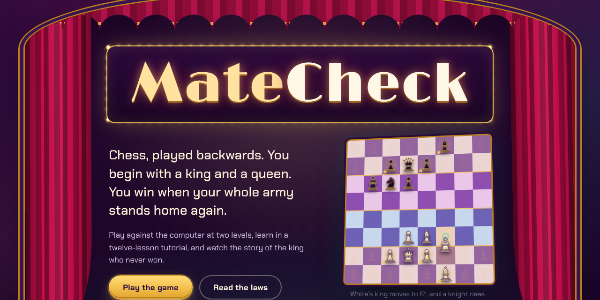

# MateCheck

**Chess, played backwards.**

In normal chess you start with a full army and end up (if things go badly) with a lonely king. MateCheck flips that. Both sides start with only a king and a queen, the fallen pieces come back one by one, and the first player to stand their whole army in the classic starting position calls **MateCheck** and wins.

It runs in the browser, you play against the computer (with a proper chess clock if you want one), and there's an animated story at the start about the king who never won a game, with its own adventure soundtrack.



## Play it

**Option 1: just open it.** Download or clone this repo and double-click `index.html`. That's it. No install, no server, works offline.

**Option 2: GitHub Pages.** Fork the repo, go to *Settings > Pages*, pick the `main` branch and the root folder, and your copy will be live at `https://<your-username>.github.io/MateCheck/` in a minute or two.

**Option 3: a local server** (if you like that better):

```bash
python -m http.server 8000
# then open http://localhost:8000
```

The music starts by itself when the page opens, as long as your browser allows it (Chrome and Edge do for sites you've played sound on before; Firefox and Safari have a per-site autoplay setting). If the browser holds it back, a small note at the bottom says so, and the music starts on your very first click, tap or key press anywhere. The cues are downloaded in the background while you wait, so it starts instantly. There's a sound toggle in the top bar.

## How a game goes

1. You press **Play the game**, the curtains close, and the story plays: a prologue that sweeps across the realm in time with the overture, then three short acts and a cliffhanger. You can skip it any time.
2. On your first visit you get a short **tutorial**: twelve quick lessons on the real board. Each one has a small task, and a *Show me* button if you get stuck.
3. Then you pick your opponent, your colour, how the match ends, a chess clock and a battlefield, and the match begins.

### The rules in one minute

- Each side starts with only its **king and queen**. Everything else waits in the reserve.
- **Rally:** when one of your pieces leaves a square on your **muster ground** (ranks 3-4 for White, 5-6 for Black), a piece from your reserve can rise on the square it just left. Most good moves raise someone.
- **Sealing:** when a pawn, knight, bishop or rook reaches its own starting square, it's sealed there for good. It can't move and can't be taken.
- **Pawns walk backwards**, toward their own second rank. From the fourth rank they can jump two squares back.
- **Bishops keep their colour.** You have a light-square bishop and a dark-square bishop in reserve.
- **Only kings and queens can capture.** Capturing doesn't kill anything, it **banishes** the piece back to its owner's reserve. Other pieces never capture and never give check.
- **Shields:** in its own half of the board, a piece with a friend standing next to it can't be banished.
- **Courts are closed:** no piece may step into the enemy's two home ranks.
- **Check exists, checkmate doesn't.** You can't leave your king in check, and a move that would leave the other king with no escape isn't allowed.
- **Recall:** if one of your pieces gets stuck, you can send it back to the reserve instead of moving.
- **Dawn:** if nobody finishes, the game ends after 100 moves each, and whoever has more pieces home wins. There's no draw by repetition, so stalling never saves you.

### Two ways to end a match

**MateCheck at Dawn** (the classic): stand all sixteen pieces on their starting squares and you win on the spot. If nobody manages it, dawn breaks after 100 moves each and more pieces home wins. With a clock, running out of time loses.

**The Grand Revival** (the idea MateCheck started from): every fallen piece has to be revived and walked back to its square. MateCheck still wins instantly, but when a clock runs out (or dawn breaks) nobody loses on time. The revival is counted instead:

| | Points |
|---|---|
| each comrade (pawn, knight, bishop, rook) standing anywhere on the board | 1 |
| each piece standing on its home square, royals included | +1 |

So a sealed rook is worth 2, a knight still walking home is worth 1, and a full army at home is 14 + 16 = 30. The higher score wins. If the scores are level, more pieces home wins; if that is level too, the side whose flag fell loses, and at dawn it's a draw. Banishing an enemy comrade knocks its score down, so the royals matter right to the last second, and the computer leans harder on the count as its clock runs low. Both scores are shown live in the side panels.

The one piece of advice I'd give: **fill your back rank first.** Sealed pawns never move again, so if you close your pawn wall too early your rooks, bishops, king and queen can never get home.

### Controls

- Click a piece, then click where it should go. Or drag it.
- When a comrade can rise behind your move, a small picker pops up. Press `1`-`5` to choose, `0` for nobody, `Esc` to cancel. (You can switch the picker off in the settings and let the game choose for you.)
- Select a piece and press **Recall** under the board to send it back to the reserve.
- `Ctrl+Z` takes back a move, `H` asks for a hint. Arrow keys and `Enter` work on the board too.
- During the story: `Space` or `Enter` for the next line, `Esc` to skip.

### The clock

Pick a time control when you start a match: **untimed**, **15 + 10**, **10 + 0**, **5 + 3** or **3 + 2** (minutes each, plus seconds added after every move). Your clock runs on your turn, the computer's on its turn. In the classic ending whoever hits zero first loses; in the Grand Revival a falling flag ends the match and the revival is counted. The last ten seconds tick. Undo puts the time back the way it was, and the clock pauses if you leave the board or switch to another tab, so a casual game is never lost to a phone call. You can also **resign** from the top bar.

### The music

The soundtrack is meant to feel like a long journey. During a match it moves through six exploration themes (the open sea, a desert caravan, a glowing forest, a voyage above the clouds, a hidden village and the mountain peaks), about a minute each, crossfading into the next. When things get tense (a king in check, someone nearly home, dawn approaching or your clock running low) it cuts to a battle theme and drifts back once it calms down. The track name shows up in the top bar.

### Opponents

- **Beginner-friendly** looks one move ahead for each side and sometimes picks a weaker idea on purpose. Good for learning.
- **Expert Courtroom** searches up to eight half-moves deep in about a second, guards its muster ground and punishes loose pieces. It's not unbeatable, but it doesn't give much away.

### Battlefields

- **The Last Stand:** both kings shield their queens near home. The default, and the easiest to learn on.
- **Crossroads:** the royals start out in open country. Expect early raids.
- **The Long Road:** each royal pair wakes up deep in enemy land and has to march home.

## What's inside

```
MateCheck/
├── index.html            the main file: landing page, story theatre and game screen
├── MateCheck.ipynb       the notebook that writes everything in assets/
├── assets/
│   ├── js/               engine, computer opponent, board, story, tutorial, game (with the clock), sound
│   ├── css/              styles and the embedded fonts
│   ├── audio/            the soundtrack (MP3), its manifest and a base64 bank for offline play
│   ├── fonts/            Limelight and Chakra Petch (SIL Open Font License)
│   └── img/              icon and cover
├── tests/                Node tests for the rules, the tutorial and computer-vs-computer games
├── requirements.txt      Python packages for the notebook
└── LICENSE               MIT
```

### The notebook

`MateCheck.ipynb` is where the whole project lives. Running it top to bottom:

1. writes the rules in Python and checks them against the JavaScript engine with perft counts (they have to match exactly),
2. tunes the computer's evaluation weights by self-play and writes `assets/js/weights.js`,
3. composes and renders all nineteen music cues from scratch with NumPy and SciPy (harps, harpsichord, choir, bells, taiko, koto, bamboo flute, accordion, brass, guitar, drums, rain, thunder...) and writes the MP3s,
4. writes every JavaScript and CSS file the page loads.

To run it:

```bash
pip install -r requirements.txt
jupyter notebook MateCheck.ipynb   # then Run All
```

A full run takes around five minutes. There are two switches at the top (`RUN_TRAINING`, `RENDER_AUDIO`) if you want to skip the slow parts.

### Tests

You need [Node.js](https://nodejs.org) for these:

```bash
node tests/engine.test.js       # rule checks (including the revival score) + 400 random games
node tests/tutorial.test.js     # every lesson loads and can be solved
node tests/selfplay.js 6 expert beginner   # watch the computer play itself
```

## How it's built

Plain HTML, CSS and JavaScript. No frameworks, no build step, no network requests (fonts and sounds ship with the repo).

- **Rules engine:** a 64-square board array, incremental Zobrist hashing, make/unmake with an undo stack. The "no checkmate" rule is enforced by checking, for every move that gives check, whether the other side still has a way out.
- **Computer opponent:** negamax with alpha-beta and principal variation search, iterative deepening, a transposition table, killer and history move ordering, late move reductions, check extensions and a quiescence search over captures. It runs in a Web Worker so the board never freezes, with a fallback to the main thread if workers aren't available.
- **Evaluation:** "work remaining". For each army it adds up how many moves every piece still needs to get home, using breadth-first search around that army's own sealed pieces, so it understands when a piece is locked out for good.
- **Sound:** music is decoded with the Web Audio API and looped sample-accurately (the MP3 encoder's lead-in is skipped using exact lengths from `manifest.js`). Move sounds are synthesized live with oscillators and noise. There's an optional narrator that uses your browser's built-in voices.
- **Clock:** measured with `performance.now()`, charged when a move is made, with the increment added and a snapshot kept per move for undo.
- **Saving:** your settings and an unfinished game (clock included) are kept in your browser's local storage, so you can close the tab and continue later.

Works in recent Chrome, Edge, Firefox and Safari (15.4+), on desktop and on phones.

## Credits

Made by **Swayam Shakya** ([@requiemdoomed](https://github.com/requiemdoomed)).

Fonts: [Limelight](https://fonts.google.com/specimen/Limelight) by Sorkin Type and [Chakra Petch](https://fonts.google.com/specimen/Chakra+Petch) by Cadson Demak, both under the SIL Open Font License (see `assets/fonts/`). Everything else (pieces, illustrations, code and music) is original.

## License

MIT. See [LICENSE](LICENSE). Use it, change it, share it, just keep the copyright notice.
